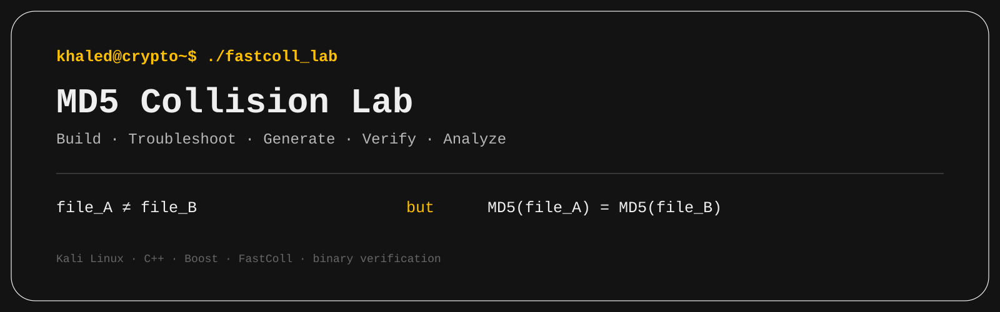
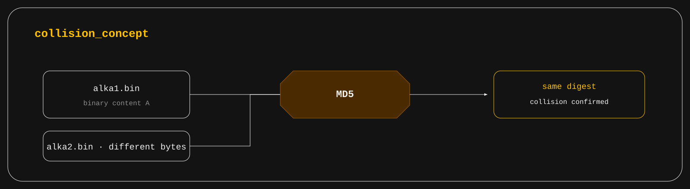
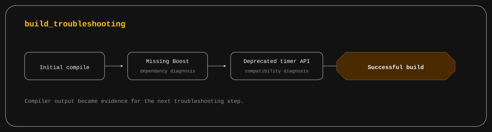
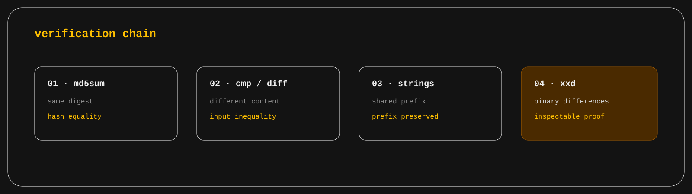

<div align="center">



</div>

---

## What this lab demonstrates

This lab documents a hands-on cryptographic experiment using **FastColl** on Kali Linux to generate two different binary files that produce the **same MD5 digest**.

The useful part of the exercise was not only the final collision.

The work also included:

```text
Explore source
      ↓
Attempt build
      ↓
Diagnose dependency failure
      ↓
Resolve Boost compatibility
      ↓
Compile successfully
      ↓
Generate collision
      ↓
Verify same MD5
      ↓
Verify different binary content
```

The result is a compact example of **cryptographic weakness + Linux troubleshooting + evidence-based verification**.

---

## The security idea in one minute

A cryptographic hash is often used as a compact fingerprint of data.

A collision occurs when two different inputs produce the same hash value.

In this lab:

```text
alka1.bin ≠ alka2.bin
       but
MD5(alka1.bin) = MD5(alka2.bin)
```

That is the important security lesson.

MD5 should not be relied on where **collision resistance** is required.

<div align="center">



</div>

---

# Lab Workflow

## 01 · Project Exploration

The FastColl source directory was inspected before compilation.

The repository included C++ source files, a README, Docker-related material, and Git metadata.

The README was reviewed to understand build requirements and expected usage.

---

## 02 · First Compilation Attempt

The initial build used GNU C++:

```bash
g++ -O2 -o fastcoll *.cpp -lboost_program_options
```

The build failed because required Boost headers were not available.

One reported missing dependency involved:

```text
boost/filesystem/operations.hpp
```

This turned the exercise into a dependency and compatibility troubleshooting task before any cryptographic testing could begin.

---

## 03 · Dependency Installation

Required development packages were installed:

```bash
sudo apt update
sudo apt install g++ libboost-all-dev
```

An unrelated NodeSource warning about a deprecated SHA1 repository signature appeared during package update.

It did not prevent installation of the dependencies required for FastColl.

---

## 04 · Boost Compatibility Fix

After Boost was installed, the build encountered another compatibility issue involving deprecated Boost timer support.

The project was successfully compiled by enabling the deprecated timer API and linking the required Boost libraries:

```bash
g++ -O2 \
  -DBOOST_TIMER_ENABLE_DEPRECATED \
  -o fastcoll *.cpp \
  -lboost_program_options \
  -lboost_filesystem
```

The result was a working executable:

```text
fastcoll
```

<div align="center">



</div>

---

## 05 · Installation Verification

The binary was tested with:

```bash
./fastcoll -h
```

The help output confirmed that the executable had been compiled correctly.

The binary was then made available through the local system path by placing it under:

```text
/usr/local/bin
```

---

## 06 · Prefix Preparation

A prefix file was created containing:

```text
Khaled Alkailani
```

This file was used as the shared prefix for the collision pair.

---

## 07 · Collision Generation

FastColl generated two binary outputs from the same prefix:

```bash
fastcoll -p khacollison.txt -o alka1.bin alka2.bin
```

Outputs:

```text
alka1.bin
alka2.bin
```

---

## 08 · Collision Verification

The MD5 digests were calculated independently:

```bash
md5sum alka1.bin alka2.bin
```

The result showed identical MD5 values for both files.

That proves the collision only when paired with a second check: the files themselves must actually be different.

---

## 09 · Confirming the Files Are Different

Several independent checks were used.

### Binary comparison

```bash
cmp alka1.bin alka2.bin
diff alka1.bin alka2.bin
```

### Prefix inspection

```bash
strings alka1.bin
strings alka2.bin
```

The shared prefix could still be identified in both files.

### Hex analysis

```bash
xxd alka1.bin > alka1.hex
xxd alka2.bin > alka2.hex
```

The hex dumps made the differing binary regions easier to inspect.

<div align="center">



</div>

---

# Why the Verification Matters

A single matching MD5 output is not enough documentation.

The lab deliberately verified both sides of the claim:

| Claim | Evidence |
|---|---|
| The hashes are identical | `md5sum` |
| The files are different | `cmp`, `diff`, hex comparison |
| The common prefix remains present | `strings` |
| Binary differences can be inspected | `xxd` |

The conclusion is therefore evidence-backed:

> Two distinct files were generated with an identical MD5 digest.

---

# Security Takeaway

The experiment illustrates the difference between a hash function existing and a hash function still being suitable for a security property.

For collision-sensitive integrity designs, MD5 is not an appropriate choice.

This does **not** mean every historical use of MD5 has the same risk model. The security impact depends on how the hash is being used.

The lesson from the lab is narrower and defensible:

> **MD5 does not provide the collision resistance expected from modern cryptographic hash functions.**

---

# Repository Structure

```text
.
├── README.md
├── SECURITY.md
│
├── assets/
│   ├── banner.svg
│   ├── collision-concept.svg
│   ├── build-troubleshooting.svg
│   └── verification-chain.svg
│
└── docs/
    ├── build-notes.md
    ├── verification-method.md
    └── security-implications.md
```

---

<div align="center">

### Khaled AlKailani

**Cybersecurity · Linux · Cryptography Fundamentals · Security Engineering**

<sub>Controlled cryptographic lab performed for educational security analysis.</sub>

</div>
